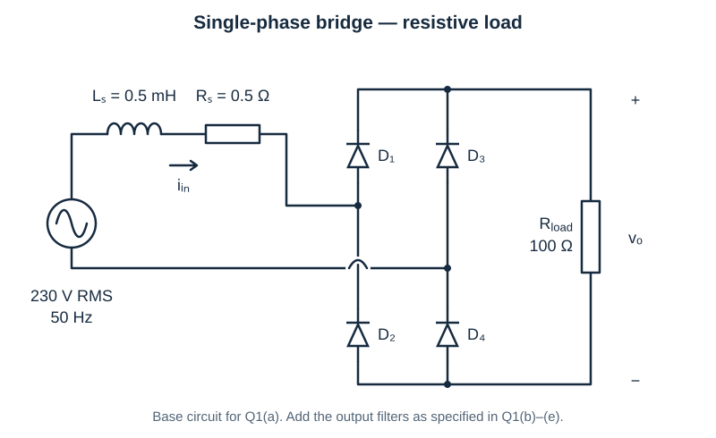
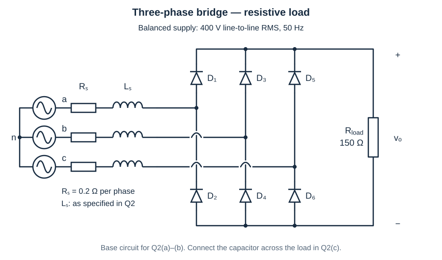

# EE 463 Homework#1

## Diode Rectifiers, Filter Design and Power Diode Losses

### Deadline: 08.11.2026, 23:59

Please check [evaluation.md](evaluation.md) for submission details and evaluation criteria. Open a **private repository** containing all your work and add [Ogün](https://github.com/OgunAltun) as a collaborator. Team assignments are announced in [Teams.md](Teams.md).

**Important:** Submit a report presenting your calculations, component selections, simulation results and answers to all questions, together with your simulation models and any supporting scripts.

Each group must also attend a **10-minute Q&A session** after submission. Both members will be asked to explain their simulations, calculations and report conclusions individually. The student working alone must also attend. See [evaluation.md](evaluation.md#qa-session) for details.

Unless otherwise stated, plot waveforms in **steady state** and for two electrical periods only. Use separate plots or clearly labelled axes where quantities have different units. Show longer intervals for startup behaviour and enlarged intervals for commutation details as needed. Calculate steady-state quantities over an integer number of line periods. State the harmonic range, measurement interval and other settings used for THD calculations, and use consistent settings for comparisons. Demonstrate on a representative capacitor-filtered case that reducing the simulation time step does not materially change the reported results.

**1) Single-phase full-bridge diode rectifier**

Consider a single-phase full-bridge diode rectifier with the following parameters:

| Parameter | Value |
| --- | --- |
| AC supply voltage | 230 V RMS |
| Supply frequency | 50 Hz |
| Source resistance, Rs | 0.5 Ω |
| Source inductance, Ls | 0.5 mH |
| Load resistance, Rload | 100 Ω |

Assume ideal diodes. Keep the source impedance and the **100 Ω load resistance unchanged throughout Question 1**.

**a) Resistive load**

Simulate the rectifier without an output filter. Plot the output voltage and input current. Measure:

- Average output voltage.
- Peak-to-peak output-voltage ripple.
- Input RMS current and input-current THD.
- Input active power and true power factor.

**b) Capacitor-filter design**

Connect a capacitor across the load. Estimate the capacitance required to obtain a peak-to-peak output-voltage ripple no greater than **10%**, showing your calculations. Determine the minimum capacitance satisfying this requirement through simulation. Assume zero capacitor ESR in this part.

Plot the output voltage and input current. Measure input-current THD, true power factor, peak diode current and capacitor RMS current. Compare with part (a) and comment on the results, including any differences between the estimated and simulated capacitance.

**c) Commercial capacitor selection and ESR**

Select a commercially available capacitor or capacitor bank meeting the capacitance, voltage and ripple-current requirements. Provide the manufacturer, part number, datasheet and reasons for your selection.

Using the selected capacitance, simulate the circuit first with zero capacitor ESR and then with the datasheet-based ESR. State the frequency and temperature associated with the ESR value and explain any assumptions or conversions used to obtain it.

Compare the output-voltage ripple and capacitor current. Calculate the average capacitor ESR loss from the simulated current and check whether the selected capacitor still meets the requirements. Comment on the results.

**d) Reducing the effect of ESR**

How can the effect of capacitor ESR on the output voltage be reduced? Propose a practical solution, implement it in your simulation and compare its performance with part (c). State any changes to capacitance or other component parameters.

**e) LC-filter design**

Replace the previous output filter with an LC filter: connect a series inductor between the bridge output and the output node, with the capacitor and load connected across the output.

Design the filter for a peak-to-peak output-voltage ripple no greater than **2%**. Choose and justify an initial LC natural frequency, and use the following relation to obtain initial component values:

$$
f_0 = \frac{1}{2\pi\sqrt{LC}}
$$

Refine your design through simulation. Include capacitor ESR and state your assumption for the inductor winding resistance.

Develop **two different L,C combinations** meeting the requirement. Compare:

- Average output voltage and peak-to-peak output-voltage ripple.
- Input-current THD and diode current stress.
- Inductor and capacitor currents.
- Startup overshoot and settling time.
- Expected component size and practicality.

Use the same source phase angle for both startup simulations, with initially uncharged capacitors and zero inductor currents. Select your preferred design, justify your choice and comment on the results.

**2) Three-phase full-bridge diode rectifier**

Consider a three-phase full-bridge diode rectifier with the following parameters:

| Parameter | Value |
| --- | --- |
| AC supply | Balanced three-phase |
| Line-to-line supply voltage | 400 V RMS |
| Supply frequency | 50 Hz |
| Source resistance, Rs | 0.2 Ω per phase |
| Load resistance, Rload | 150 Ω |

Assume ideal diodes. Keep the **150 Ω load resistance unchanged throughout Questions 2 and 3**.

**a) Unfiltered operation**

With zero source inductance and no output capacitor:

- Plot the output voltage and all three line currents.
- Measure average output voltage, peak-to-peak output-voltage ripple, phase-A current THD and total input power factor.
- Identify the dominant output-voltage ripple frequency.
- Plot the phase-A current spectrum through the 40th harmonic.

**b) Source-inductance effects**

Repeat part (a) with source inductances of **0.5 mH and 2 mH per phase**.

Compare average output voltage, output ripple, line-current THD and peak diode current for all three source-inductance values. Show an enlarged commutation interval with the relevant diode currents. Explain the current transfer between phases and comment on the results.

**c) Capacitor filtering**

Using **0.5 mH source inductance per phase**, determine a DC-link capacitance giving a peak-to-peak output-voltage ripple no greater than **2%**. Connect the capacitor across the load and assume zero capacitor ESR in this part.

Plot the output voltage and phase-A input current. Compare filtered and unfiltered operation at the same source inductance in terms of average output voltage, output ripple, line-current THD, power factor and diode peak/RMS current.

Does improving the DC output waveform also improve the AC input waveform? Comment on the results.

**3) Real diode selection and losses**

Use only the **three-phase capacitor-filtered circuit from Question 2(c)**. Keep its supply, source impedance, capacitance and **150 Ω load resistance unchanged**.

**a) Device selection**

Using the ideal-diode simulation, measure the average, RMS and peak forward current and maximum reverse voltage of a diode. Select a suitable commercial power diode. Provide its manufacturer, part number and datasheet, and justify the selection using the measured stresses and datasheet rating conditions.

**b) Nonideal diode model**

Extract a piecewise-linear forward-voltage model from the selected diode's datasheet:

$$
v_D = V_0 + r_D i_D
$$

State the junction temperature and current range used, and show how you obtain V0 and rD. Verify the forward-conduction model against the datasheet characteristic using a separate current sweep, then replace all ideal diodes in the rectifier with this model. Plot the output voltage and phase-A input current.

This model is used to study **conduction losses**. Reverse-recovery modelling is not required.

**c) Simulated diode losses**

Plot the instantaneous voltage, current and power of one diode using consistent voltage and current reference directions. Calculate the average loss of every diode from its simulated voltage and current, and find the total bridge semiconductor loss.

Compare the simulated losses with calculations using the measured average and RMS diode currents and your piecewise-linear model. Calculate both current quantities over complete steady-state line periods, including intervals when the diode is off. Comment on the results.

**d) Effect on rectifier performance**

Compare the ideal and nonideal diode simulations in terms of average output voltage, output ripple, input power, output power and efficiency. Comment on the results.
