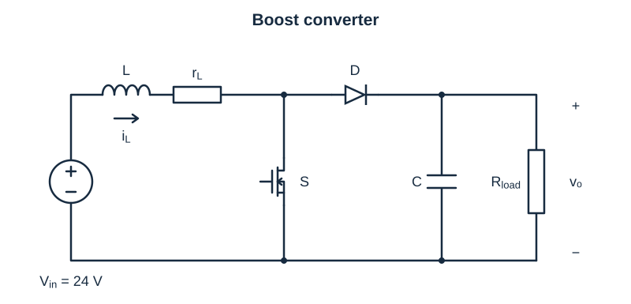
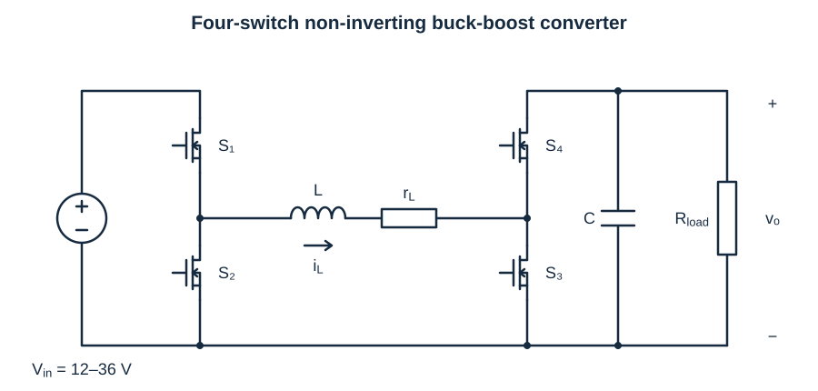

# EE 463 Homework#2

## Power Semiconductor Technologies and Non-isolated DC–DC Converters

### Deadline: 06.12.2026, 23:59

Please check [evaluation.md](evaluation.md) for submission details and evaluation criteria. Open a **private repository** containing all your work and add [Ogün](https://github.com/OgunAltun) as a collaborator. Team assignments are announced in [Teams.md](Teams.md).

**Important:** Submit a report presenting your derivations, device selections, simulation results and answers to all questions, together with your simulation models and the scripts used for parameter sweeps.

Each group must also attend a **10-minute Q&A session** after submission. Both members will be asked to explain their derivations, simulations and report conclusions individually. See [evaluation.md](evaluation.md#qa-session) for details.

Unless otherwise stated:

- Plot waveforms in **steady state** over a few switching periods. Calculate average and RMS quantities over an integer number of switching periods after the simulation has settled. State the settling criterion you used.
- Switching transitions are ideal (instantaneous). **Only conduction losses are modelled in this homework**; switching losses are not required.
- Model a conducting MOSFET as a resistance RDS(on) and a conducting diode with the piecewise-linear model vD = VF0 + rD iD, where VF0 is the diode threshold voltage and rD is the diode on-state resistance (see Homework 1). In Question 2, use datasheet values of your selected devices at **Tj = 100 °C** and show how you obtained them. In Question 3, use the values given in the parameter table.
- Parameter sweeps must be automated with scripts (MATLAB, Python or the scripting tool of your simulator). Include the scripts in your repository.
- Demonstrate on a representative case that reducing the simulation time step does not materially change the reported results.

**1) Power semiconductor technologies**

Answers to this question should be brief: a table and short paragraphs are sufficient.

**a) Device selection**

Select one commercial device from each of the following technologies, all in the **600–750 V** class and with a similar current capability (roughly 20–40 A continuous at TC = 25 °C):

- Si MOSFET
- Si IGBT (a co-packaged anti-parallel diode is allowed)
- SiC MOSFET
- GaN HEMT

Give the manufacturer, part number and datasheet for each device. Tabulate the voltage and current ratings, conduction parameter (RDS(on) or VCE(sat)) at 25 °C and at an elevated junction temperature, total gate charge, output-capacitance energy or Coss, reverse-recovery charge of the body or anti-parallel diode, junction-to-case thermal resistance and package. State the test conditions of each value.

**b) Conduction behaviour**

Using the datasheet output characteristics, compare the conduction voltage drop of the four devices at **5 A and 20 A** at the elevated junction temperature. Explain the difference between the resistive conduction of MOSFETs and HEMTs and the knee voltage of the IGBT, and comment on the temperature dependence of each technology.

**c) Switching behaviour and application matching**

Explain briefly which datasheet parameters determine the switching losses of each technology, considering the IGBT tail current, body-diode reverse recovery and the absence of reverse-recovery charge in GaN HEMTs. Using these arguments and your results from part (b), choose the most suitable technology for each application and justify your choice:

- A 16 kHz, 5 kW motor drive on a 400 V DC bus.
- A 300 kHz, 65 W adapter power-factor-correction stage.
- A 100 kHz, 3.3 kW on-board charger.

**2) Boost converter**

| Parameter | Value |
| --- | --- |
| Input voltage, Vin | 24 V |
| Output voltage, Vo | 48 V |
| Rated output power | 100 W |
| Load resistance, Rload | 23.04 Ω (rated load) |
| Switching frequency | 100 kHz |
| Output capacitance, C | 47 µF (zero ESR) |
| Inductor winding resistance, rL | 0.2 Ω (where stated) |

Keep **Vin = 24 V** and **Rload = 23.04 Ω** unless stated otherwise.

**a) Ideal operation**

Assume ideal components. Derive the minimum inductance Lmin that keeps the converter in continuous conduction mode (CCM) at rated power. Simulate the converter with L = Lmin and plot:

- Inductor voltage and current
- Output voltage (ripple)
- Diode voltage and current
- Switch voltage and current

Comment on the results.

**b) Device selection**

Using the stresses from part (a), select a commercial MOSFET and a commercial diode for the converter. Provide their manufacturers, part numbers and datasheets, and justify your selection. Extract RDS(on), VF0 (diode threshold voltage) and rD (diode on-state resistance) at Tj = 100 °C. These values are used in the remainder of Question 2.

**c) Nonideal CCM model**

Include rL, RDS(on) and the diode model vD = VF0 + rD iD (VF0: diode threshold voltage, rD: diode on-state resistance). Neglect the inductor-current and capacitor-voltage ripple (small-ripple approximation). Derive:

- The voltage gain M(D) = Vo/Vin
- The efficiency η(D) = Po/Pin

Show your steps clearly. Explain how each loss element enters the gain expression. For the case where only rL is present, find the duty cycle at which the gain is maximum and the maximum gain.

**d) Duty-cycle sweep: model versus simulation**

Use **L = 47 µH** in this part. Simulate the nonideal converter at **at least 15 duty-cycle values between 0.10 and 0.95**, with denser points around the maximum gain. Keep Vin and Rload fixed. This is a model-validation study; operating points beyond the ratings of your devices are acceptable in simulation.

On the same axes, plot your derived M(D) and the simulated gain. Repeat for η(D). Also plot the relative error between model and simulation against duty cycle. Mark the predicted and simulated maximum-gain points.

Where is the error largest? Explain the sources of the discrepancy.

**e) Rated operation with two inductances**

Operate the nonideal converter at the rated point (adjust D to obtain Vo = 48 V) with **L = Lmin** and with **L = 47 µH**. For both cases, compare the simulated loss breakdown (rL, MOSFET and diode) and efficiency with the predictions of your averaged model.

Explain the differences.

**f) Discontinuous conduction mode**

Assume ideal components and use **L = Lmin** from part (a). Derive the condition for the CCM–DCM boundary and the voltage gain in DCM as a function of duty cycle and load.

Keep the duty cycle fixed at the ideal rated value (D = 0.5) and vary the load from **150% to 10% of rated power in at least 10 steps**. Plot the derived and simulated gain against output power on the same axes and mark the CCM–DCM boundary. Show the inductor current at a CCM point, at the boundary and at a deep-DCM point. Comment on the results.

**3) Four-switch non-inverting buck-boost converter**

| Parameter | Value |
| --- | --- |
| Input voltage range, Vin | 12–36 V |
| Output voltage, Vo | 24 V |
| Rated output power | 100 W |
| Load resistance, Rload | 5.76 Ω (rated load) |
| Switching frequency | 100 kHz |
| Inductance, L | 22 µH |
| Inductor winding resistance, rL | 30 mΩ |
| Output capacitance, C | 100 µF (zero ESR) |
| Dead time (synchronous operation) | 100 ns |
| MOSFET on-state resistance, RDS(on) (all four switches) | 10 mΩ |
| MOSFET body diodes | VF0 = 0.8 V, rD = 30 mΩ |
| Diodes D2 and D4 (non-synchronous version) | VF0 = 0.5 V, rD = 20 mΩ |

In the **non-synchronous** version, S2 is replaced by a diode D2 (anode to ground, cathode to the input switching node) and S4 by a diode D4 (anode to the output switching node, cathode to the output). In the **synchronous** version, model the MOSFET body diodes with the parameters in the table; they conduct during the dead time. No commercial device selection is required in Question 3.

The output voltage must be regulated to **24 V ± 1%** at every reported operating point. You may adjust the duty cycle with a script or use a simple controller; state which method you used. Closed-loop dynamics are not evaluated.

**a) Operating modes**

Explain the **buck**, **boost** and **buck-boost** operating modes of the converter. For each mode, state which switches are pulse-width modulated, which are held on or off, and the ideal relation between duty cycle and voltage gain. Explain how each mode is implemented in both the synchronous and non-synchronous versions.

**b) Non-synchronous versus synchronous operation**

At rated load, simulate both versions at **Vin = 12 V (boost mode)** and **Vin = 36 V (buck mode)**. Plot the inductor current, the switching-node voltages and the currents of the freewheeling devices, including an enlarged view of one dead-time interval.

Compare the conduction loss of every device and the efficiency of the two versions. Quantify the loss caused by body-diode conduction during the dead time. Comment on the results.

**c) Mode-based versus buck-boost-mode operation**

Use the synchronous version at rated load. Sweep the input voltage from **12 V to 36 V in 2 V steps** for two operating strategies:

- **Mode-based:** boost mode for Vin ≤ Vo and buck mode for Vin > Vo.
- **Buck-boost mode:** all four switches switching at every input voltage.

For both strategies, plot against input voltage the average, RMS and peak inductor currents, the RMS current of each switch, the loss breakdown (rL and each switch) and the efficiency. Explain the differences. Which strategy would you use, and why?

**d) Operation near Vin ≈ Vo**

Use the synchronous version at rated load. Assume that every switch has a **minimum on-time and minimum off-time of 200 ns**. The complementary switch must also satisfy the minimum on-time. Using your nonideal model, determine by simulation the input-voltage window in which neither buck mode nor boost mode can regulate the output to 24 V ± 1%.

Propose an operating strategy for this window and demonstrate by simulation that it regulates the output at one input voltage inside the window. Compare its losses with the neighbouring buck-mode and boost-mode points.

**e) Light-load operation**

At **Vin = 36 V** in buck mode, reduce the load to **50%, 20%, 10% and 5%** of rated power. Compare the non-synchronous version with the synchronous version operating with continuous PWM (no diode emulation or pulse skipping).

Plot the inductor current at 10% load for both versions and the efficiency of both versions against output power. Explain the negative inductor current in the synchronous version and its effect on losses. How do practical controllers improve light-load efficiency?

Which version can transfer power from the output side back to the input side? Explain with reference to your light-load results.
